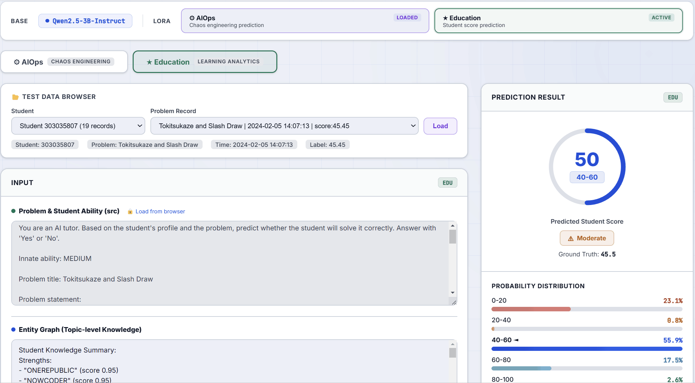

# CogGuard 

This document describes the main workflow of the CogGuard, which contains two modules: Cognitive Profiling and Profile-to-Score Alignment.




# Dataset

The original dataset archive is stored in `Datasets.zip`.

Available data artifacts in this repository include:

- Example education-scenario data for quick inspection and testing: `edu_data/`
- Example ops-scenario data for quick inspection and testing: `ops_data/`
- Education-scenario efficiency / speed test results: `Cognitive Profilng/edu_data(efficiency test)/`
- Raw ops datasets, task definitions, logs, and timing-related files: `Cognitive Profilng/ops/`
- Processed alignment datasets: `Profile-to-Score Alignment/datasets/`

Large artifacts are distributed separately:

- Complete education-scenario graph construction outputs for `Cognitive Profilng/edu_data/`: download from [Google Drive](https://drive.google.com/drive/folders/1H-IYYixwArmH64ekR974wCBVUmnQoXkf?usp=sharing)
- Demo LoRA checkpoints for `demo/checkpoints/`: download from [Google Drive](https://drive.google.com/drive/folders/1H-IYYixwArmH64ekR974wCBVUmnQoXkf?usp=sharing)

The repository may keep only placeholder directories for these large folders. Download them when you need the full artifacts.

---

## Quick Start

For a minimal first run:

1. Install dependencies:

```bash
pip install -r requirements.txt
```

2. Download large artifacts from [Google Drive](https://drive.google.com/drive/folders/1H-IYYixwArmH64ekR974wCBVUmnQoXkf?usp=sharing) and place them in:

- `Cognitive Profilng/edu_data/`
- `demo/checkpoints/`

3. Start the demo:

```bash
cd demo
python app.py --port 7860 --preload ops
```

4. For full data preparation, training, and inference workflows, continue reading the sections below or see `demo/README.md` for demo-specific details.

---

## Table of Contents

- [Cognitive Profiling](#cognitive-profiling)
  - [Education Scenario (Edu Scenario)](#education-scenario-edu-scenario)
  - [Operations Scenario (Ops Scenario)](#operations-scenario-ops-scenario)
- [Profile-to-Score Alignment](#profile-to-score-alignment)
  - [Data Preparation](#data-preparation)
  - [Dataset Splitting](#dataset-splitting)
  - [Training](#training)
  - [Inference and Validation](#inference-and-validation)
  - [Demo Frontend](#demo-frontend)

---

## Cognitive Profiling

### Education Scenario (Edu Scenario)

Available education-scenario artifacts:

- Root-level example data is stored in `edu_data/`
- Full dual-graph construction results for `Cognitive Profilng/edu_data/` are provided separately on [Google Drive](https://drive.google.com/drive/folders/1H-IYYixwArmH64ekR974wCBVUmnQoXkf?usp=sharing)
- Efficiency / speed test results for different settings are stored in `Cognitive Profilng/edu_data(efficiency test)/`

#### 1. Data Collection

Collect online C++ exercise data:

```bash
python "Cognitive Profilng/nowcoder.py"
```

#### 2. Graph Construction

Run the following scripts sequentially to construct graphs and extract the summary as profile files:

```bash
# Build graph from scratch
bash "Cognitive Profilng/run_our1.sh"

# Build graph after adding new data to existing student records
bash "Cognitive Profilng/run_our2.sh"
```

**Note**: `run_our1.sh` is used for building from scratch, while `run_our2.sh` is used for building graphs after adding new data to existing student records.

---

### Operations Scenario (Ops Scenario)

Available ops-scenario artifacts:

- Raw chaos engineering datasets, task definitions, execution logs, and merged timing outputs are stored under `Cognitive Profilng/ops/`

#### 1. Get Failure Combination Data

Run the script to get failure combination CSV files:

```bash
python "Cognitive Profilng/ops/chaos_system_network.py"
```

#### 2. Data Splitting

Split the original CSV file to prepare data for heterogeneous machine experiments:

```bash
python "Cognitive Profilng/ops/csv_splitter.py"
```

#### 3. Fault Injection and Model Testing

Execute fault injection and model testing on heterogeneous machines, with models deployed via K8s / Docker:

```bash
# Image to text
python "Cognitive Profilng/ops/i2t.py"

# Text to text
python "Cognitive Profilng/ops/t2t.py"
```

#### 4. Build Dataset

```bash
python "Cognitive Profilng/ops/build_dataset.py"
```

---

## Profile-to-Score Alignment

### Data Preparation

#### 1. Merge Student Data

Merge chronologically processed student data to generate `all.jsonl`:

```bash
python "Profile-to-Score Alignment/merge_train_test.py"
```

#### 2. Generate Text Version Dataset

Generate merge files (text version of the dataset):

```bash
python "Profile-to-Score Alignment/merge_and_enrich_data.py"
```

#### 3. Data Filtering

Filter the previously generated `merge.jsonl` raw file:

```bash
python "Profile-to-Score Alignment/merge_data_filter.py"
```

#### 4. Generate Tokenizer Files

```bash
python "Profile-to-Score Alignment/merge_and_enrich_data.py"
```

#### 5. Batch Processing with Scripts

The above operations can also be performed directly using scripts. **Note**: `prepare_all_models_40_vf.sh` should use the filtered raw file.

```bash
# Education scenario data processing
bash "Profile-to-Score Alignment/prepare_all_models_40_vi.sh"
bash "Profile-to-Score Alignment/prepare_all_models_40_vf.sh"

# EIP data processing in education scenario
bash "Profile-to-Score Alignment/prepare_all_models_eip.sh"

# Ops scenario data processing
bash "Profile-to-Score Alignment/prepare_all_models_ops.sh"
```

---

### Dataset Splitting

#### 1. Create Dataset Directories

Create folders (same operation for 20, 30, etc. number of students):

```bash
mkdir "./datasets/students_40_new"
mkdir "./datasets/students_40"
```

#### 2. Move Processed Data Files

Move the generated `all_processed_40_model***.jsonl` files (labels are still in regression format) to the corresponding directories, then execute:

```bash
python "Profile-to-Score Alignment/split_all_datasets_vi.py"
python "Profile-to-Score Alignment/split_all_datasets_vf.py"
```

#### 3. Distributed Training Data Generation

Generate distributed training data (including mask and label format processing), then place them on fixed paths of distributed machines:

**Education Scenario:**
```bash
python "Profile-to-Score Alignment/split_our_dataset_edu.py"
```

**Operations Scenario:**
```bash
python "Profile-to-Score Alignment/split_our_dataset_ops.py"
```

#### 4. Baseline Data Format

Generate the format required for baselines:

```bash
python "Profile-to-Score Alignment/split_all_datasets_no_embedding.py"
python "Profile-to-Score Alignment/reformat_datasets_label.py"
```

**Tip**: The dataset with the suffix `no_embedding` is used by `Profile-to-Score Alignment/inference/EI.py` and `Profile-to-Score Alignment/inference/SimpleKT.py`.

Please check the integrity of the vector database before using the EI method, even though we did not perform graph clustering. (`Profile-to-Score Alignment/EI/run_fix_vdb.sh`)

The dataset with the suffix `_reformatted` is used by `Profile-to-Score Alignment/inference/SLM_Probe.py` and `Profile-to-Score Alignment/inference/GCN-Embed.py`.

---

### Training

#### Our Method

```bash
python "Profile-to-Score Alignment/finetune_stu20_our_3nodes.py"
```

**Tip**: Ablation experiments and comparison experiments can be implemented by replacing parameter switches in the script. Specifically, PRay needs to replace `split_data_3b_ray_20_ray_3nodes` in `finetune_stu20_ray_3nodes.py` with `split_data_3b_ray_20_our_3nodes`.
CRay needs `enable_ctrastive_pass=True` in `finetune_stu20_ray_3nodes.py`.

The multi-server experiment includes a single node (FlashBack) by adjusting the number of `numw_workers` in `finetune_stu20_our_3nodes.py` and `num_workers` in `split_our_dataset_edu.py`.

Multi-model experiments are achieved by changing the training set, validation set, and `inference/inference_our.py`. Please note that the values of `MARK_R` vary among different models.

#### EIP Method

```bash
python "Profile-to-Score Alignment/finetune_stu20_eip_3nodes.py"
```

---

### Inference and Validation

Model inference and baseline training/inference experiments are located in the following directory:

```text
Profile-to-Score Alignment/inference/
```

This directory contains the following inference scripts:

- `EI.py` - EI method inference
- `GCN-Embed.py` - GCN-Embed method inference
- `inference_eip.py` - EIP method inference
- `inference_our.py` - Our method inference
- `SimpleKT.py` - SimpleKT method inference
- `SLM_Probe.py` - SLM Probe method inference

#### Validation Data Generation

Generate validation data for testing the `summary_sentity` metric:

```bash
python "Profile-to-Score Alignment/summary_sentity_datasets_eip.py"
```

---

### Demo Frontend

The demo frontend entry is `demo/app.py`, and detailed demo / offline evaluation instructions are available in `demo/README.md`.

Default relative paths used by the demo:

- Base model: `demo/base_model/Qwen2.5-3B-Instruct`
- EDU raw demo data: `demo/datas/test_raw_40_new.jsonl`
- OPS raw demo data: `demo/datas/test_raw_ops.jsonl`
- EDU LoRA checkpoint: `demo/checkpoints/edu/Qwen2.5-3B-Instruct/stu20_node3`
- OPS LoRA checkpoint: `demo/checkpoints/ops/Qwen2.5-3B-Instruct`

Offline evaluation assets in `demo/`:

- Batch inference scripts: `demo/ssh/inference_*.py`
- Tokenized test files: `demo/checkpoints/test_data/`
- Exported extreme-error analysis: `demo/ssh/outputs/`

Checkpoint files for `demo/checkpoints/` are provided on [Google Drive](https://drive.google.com/drive/folders/1H-IYYixwArmH64ekR974wCBVUmnQoXkf?usp=sharing).

Start command:

```bash
cd "demo"
python app.py --port 7860 --preload ops
```

For the full demo configuration, multi-model offline evaluation setup, and directory layout, see `demo/README.md`.
